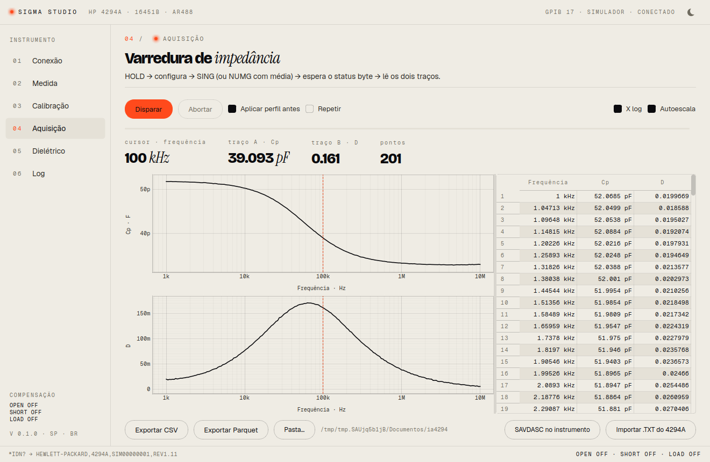
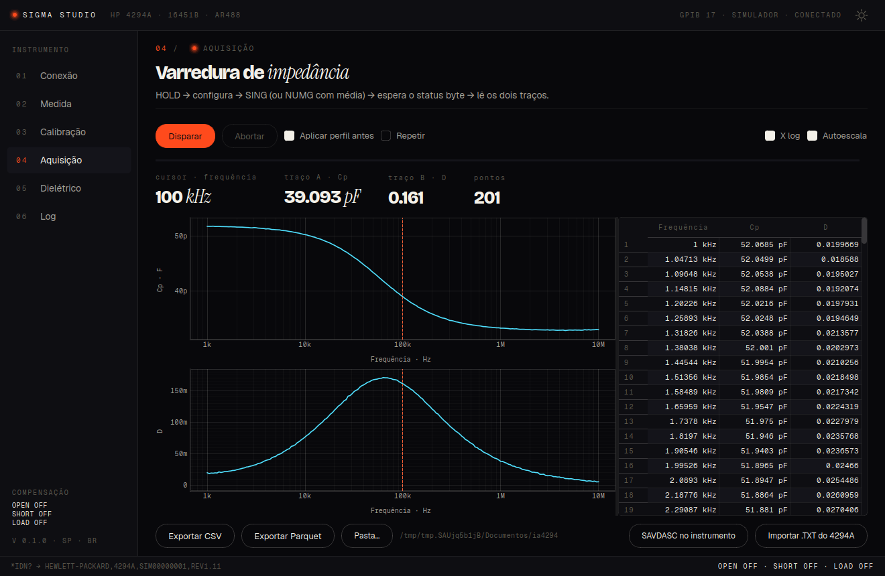

# SIGMA Studio

[](https://github.com/phareon-corp/SIGMA-Studio/actions/workflows/windows.yml)

> Antes `ia4294`. O pacote Python, o diretório de configuração e os metadados
> dos arquivos exportados continuam com o nome antigo — a instalação de quem já
> usa não muda de lugar.

Aplicativo de bancada para controlar e coletar dados do **HP/Agilent 4294A**
(fixture dielétrica **16451B**) através da interface GPIB-USB caseira **AR488
num Arduino Mega 2560**. Desktop, PySide6 + pyqtgraph. Nada de web.

## Estado

- O app **ainda não rodou contra o 4294A real**: tudo foi exercitado contra o
  simulador embutido, que roda sem instrumento nenhum (`--sim`).
- Por isso os comandos de transferência de array são convenção até o
  `sigma-studio-probe` confirmá-los na primeira conexão real — veja
  [O que é certo e o que é convenção](#o-que-é-certo-e-o-que-é-convenção).
- Versão publicada: **v0.1.0**, com instalador de Linux e de Windows em
  [Releases](https://github.com/phareon-corp/SIGMA-Studio/releases).

|  |  |
|---|---|
| Aquisição, terreno **claro** — o padrão | a mesma tela no terreno **escuro** |

As seis páginas nos dois terrenos estão em [`docs/img/`](docs/img/).

O hardware tem documentação própria, no repositório do firmware AR488 para
Arduino Mega 2560 — **material do autor, ainda não publicado**. O que vem de lá
e está embutido aqui:

- `/dev/ttyACM0`, 115 200 8N1; a placa **reseta por DTR** ao abrir a porta. O app
  espera 2 s e descarta o banner;
- `++addr 17`, **`++eos 2`** (LF puro: com CR/CRLF o 4294A ignora calado),
  `++eoi 1`, `++read_tmo_ms`;
- toda leitura em duas etapas: comando, depois `++read eoi`.

---

## Sumário

- [Requisitos](#requisitos)
- [Instalar](#instalar)
- [Usar](#usar)
  - [Detecção automática](#detecção-automática)
- [O que é certo e o que é convenção](#o-que-é-certo-e-o-que-é-convenção)
- [Quando dá errado](#quando-dá-errado)
- [Limitações conhecidas](#limitações-conhecidas)
- [Exportação](#exportação)
- [Onde ficam as coisas](#onde-ficam-as-coisas)
- [Arquitetura](#arquitetura)
- [Testes](#testes)
- [Windows](#windows)
- [Empacotar](#empacotar)
- [Design](#design)
- [Créditos e licença](#créditos-e-licença)

## Requisitos

| O quê | Detalhe |
|---|---|
| Analisador | HP/Agilent **4294A** (40 Hz – 110 MHz) |
| Fixture | **16451B** (dielétrica, quatro eletrodos) |
| Interface GPIB | **AR488 em Arduino Mega 2560** com o firmware correspondente. Firmware e pinagem vivem noutro repositório, do autor, **ainda não publicado**; o projeto AR488 original é de Twilight-Logic |
| Cabo | GPIB (IEEE 488) do 4294A à interface, e USB da placa ao PC |
| Sistema | **Linux** (porta `/dev/ttyACM0`, usuário no grupo `dialout`) ou **Windows 10/11 64 bits** (porta `COM*`) |
| Python | só para quem instala do código: **≥ 3.11**. A CI compila com 3.12 |

**Sem instrumento nenhum o app abre e funciona inteiro**, contra o simulador
embutido — é a maneira recomendada de experimentar antes de encostar no 4294A.

## Instalar

**Pacote pronto** (não precisa de Python nem de venv) — em
[Releases](https://github.com/phareon-corp/SIGMA-Studio/releases):

```bash
# Linux x86_64
tar xzf sigma-studio-0.1.0-linux-x86_64.tar.gz
sigma-studio-0.1.0-linux-x86_64/instalar.sh     # ~/.local, sem root, cria o atalho
```

No Windows, `sigma-studio-0.1.0-windows-setup.exe` (instalação por usuário, sem
UAC). Para desinstalar no Linux, `desinstalar.sh` do mesmo pacote — ele não
toca em configuração nem nos dados exportados.

**Do código**, para desenvolver:

```bash
git clone https://github.com/phareon-corp/SIGMA-Studio.git
cd SIGMA-Studio
python3 -m venv .venv
.venv/bin/pip install -e '.[dev]'
```

No Windows, o mesmo com `.venv\Scripts\`:

```powershell
git clone https://github.com/phareon-corp/SIGMA-Studio.git
cd SIGMA-Studio
python -m venv .venv
.venv\Scripts\pip install -e ".[dev]"
```

A porta é `root:dialout`; o usuário precisa estar no grupo `dialout` (com
logout/login depois do `usermod -aG dialout $USER`).

## Usar

```bash
.venv/bin/sigma-studio                 # abre a janela
.venv/bin/sigma-studio --sim           # já conecta no simulador
.venv/bin/sigma-studio-probe           # descobre comandos de array no 4294A real
.venv/bin/sigma-studio-probe --sim     # o mesmo, no simulador
```

| Opção | O que faz |
|---|---|
| `--sim` | conecta no simulador ao abrir, sem instrumento |
| `--sim-speed F` | escala de tempo do simulador (padrão `0.1`; `1` aproxima os tempos reais de varredura) |
| `--tema claro\|escuro\|sistema` | terreno da sessão; `sistema` segue o `color-scheme` do GNOME ou o registro do Windows |
| `--page N` | página inicial, de 1 (Conexão) a 6 (Log) |

Opções de desenvolvimento — o próprio `--help` as marca como `(dev)`, e são
elas que a CI usa no teste de fumaça do executável congelado:

| Opção | O que faz |
|---|---|
| `--screenshot PNG` | salva a janela e sai; com `{page}` no nome, percorre as seis páginas |
| `--acquire` | dispara uma varredura assim que conectar |
| `--size LxA` | tamanho fixo da janela, por exemplo `1366x700` |

Variáveis de ambiente:

| Variável | O que faz |
|---|---|
| `IA4294_HOME` | redireciona configuração, logs e dados para um único diretório; é o que a suíte usa para não sujar a casa de ninguém |
| `IA4294_TERRENO` | terreno da sessão, com os mesmos valores de `--tema` |
| `IA4294_REDUCED_MOTION=1` | desliga o pulso do ponto, como o "reduzir animações" do GNOME |
| `QT_QPA_PLATFORM=offscreen` | não é do app, é do Qt: necessária para rodar a suíte (e as capturas) sem tela |

A precedência do terreno é a que o código aplica, nesta ordem: `--tema`, depois
`IA4294_TERRENO`, depois o que ficou salvo em `QSettings` na chave
`ui/terreno`, e por fim o padrão — **claro**.

Atalhos: `Ctrl+1`…`Ctrl+6` trocam de aba; `Ctrl+T` troca o terreno; `Esc` aborta
o job em curso. O botão de sol/lua no canto da barra superior faz o mesmo e
desenha **para onde o clique leva** (lua = ir para o escuro). Quem troca na
janela fixa a escolha; `--tema` e `IA4294_TERRENO` valem só para a sessão.

### Detecção automática

O botão **Detectar**, na página 01, descobre sozinho em que porta a interface
está, a que velocidade ela fala e em que endereço o instrumento responde —
igual no Linux e no Windows, porque nada ali depende do nome da porta.

A resposta não é palpite: cada candidata é **aberta e interrogada**.

1. as portas entram ranqueadas, quem tem VID de Arduino/CH340/FTDI primeiro.
   Portas **sem VID USB** (as `/dev/ttyS*` do chipset, `COM1`) ficam de fora —
   são 32 numa placa comum, e nenhuma delas é a interface;
2. em cada porta, as velocidades prováveis, começando por 115 200 (o padrão do
   firmware), depois 57 600 e 9600. Quem responde **`++ver`** com "AR488" é a
   interface, e a velocidade que funcionou é a velocidade — enquadramento 8N1;
3. `++eos 2` entra **antes** de qualquer conversa com o instrumento: com CR ou
   CRLF o 4294A ignora calado, e a busca de endereço daria "ninguém em casa"
   nos 31;
4. **`++fndl`** lista quem está no barramento; se o firmware não tiver o
   comando, o app varre os endereços de 1 a 30 perguntando `*IDN?`;
5. cada endereço achado leva um `*IDN?`, e quem disser **4294A** é o alvo. O
   app preenche o formulário com o que achou e conecta.

O que a varredura devolve aparece na ficha *Estado da interface*: porta,
velocidade, firmware do AR488 e a lista do barramento. Quando não acha, diz
**por que** — porta ocupada, sem permissão, nenhuma respondeu `++ver`, ou
interface achada e barramento vazio (cabo GPIB solto, instrumento desligado).

Detectar abre e fecha portas por conta própria, então só funciona com a porta
livre: desconecte antes. A varredura inteira é um job da thread da porta, com
andamento na tela e `Esc` para abortar.

### Fluxo típico

1. **Conexão:** clique **Detectar** e deixe o app achar porta, velocidade e
   endereço ([como funciona](#detecção-automática)). No braço: escolha a porta
   (ou `SIMULADOR`) e Conectar. Nos dois casos o app manda `*IDN?` e lê o
   estado da compensação.
2. **Probe**, só na primeira vez com o instrumento real: **Rodar probe**, na
   mesma aba. Grava `~/.config/ia4294/capacidades.json`. Veja abaixo por quê.
3. **Medida:** ajuste os parâmetros e salve como perfil. **Aplicar ao
   instrumento** envia bloco a bloco e confere `OUTPERRO?` depois de cada um.
   O painel "Mensagens que serão enviadas" mostra exatamente o que vai pelo
   GPIB.

   **Varredura de bias (C-V) ou de nível do oscilador:** em *Varre · SWPP*
   escolha `DCB` ou `OLEV`. STAR/STOP passam a ser volts (ou ampères), a
   *Frequência fixa · CWFREQ* é onde todos os pontos são medidos, e o tipo fica
   travado em LIN — log e list só existem varrendo frequência (manual, cap. 10).
   Em DCB o app manda `DCMOD` e `DCO ON` e não manda `DCV`/`DCI`; em OLEV não
   manda `POWE`. Limites: bias 0 a ±40 V ou ±100 mA, oscilador 5 mV–1 V ou
   200 µA–20 mA. O envelope V×I do bias (Figura 10-1) não é retangular, e isso
   aparece como aviso, não como bloqueio.

4. **Calibração**, três procedimentos (Operation Manual, cap. 4 e 6):
   - **A · Setup do adaptador**, uma vez: `E4TP M1` → PHASE COMP (`ECALP`,
     alguns minutos, contatos em OPEN) → `ECALDON`. Fica gravado no 4294A;
     refaça se a temperatura mudar mais de 5 °C.
   - **B · Compensação do fixture**, a cada montagem: OPEN → SHORT → (LOAD).
     Cada uma liga sozinha ao terminar. Com LOAD, as teclas do 16451B são
     invertidas (`COMC` no OPEN, `COMA` na carga), e a tela mostra isso.
     O oscilador é limitado a 500 mV durante a compensação.
   - **C · Calibração de usuário** (`CALA/CALB/CALC/CALDON`): só com 42942A
     ou 42941A. Com 4TP 1M o manual diz que não pode ser feita, e a aba
     explica isso em vez de deixar tentar.

   O estado (adaptador, OPEN/SHORT/LOAD, CALST) fica no topo da aba, na barra
   lateral e no rodapé. Se um passo longo "terminar" em menos de 3 s, o app
   marca **conferir**: confira na tela do 4294A se o rótulo mostra [DONE].
5. **Aquisição:** Disparar. O ciclo é `HOLD → configura → SING` (ou `NUMG n`
   com média) `→ espera → lê`. "Repetir" encadeia varreduras para ver ao vivo.
   O cursor (arraste, ou clique no gráfico ou na tabela) lê A e B.
6. **Dielétrico:** espessura e diâmetro do eletrodo → ε′ e tan δ.
7. **Exportar:** CSV ou Parquet, um arquivo por corrida, nome
   `4294A_AAAAMMDD-HHMMSS_<MEAS>.csv`.

> **Segurança.** Desligue o bias (`DCO OFF`, botão na aba Medida) antes de
> conectar ou desconectar qualquer acessório: o manual avisa que o bias pode
> destruir o dispositivo (cap. 4). Que o **16451B aceita bias DC** ainda
> precisa ser confirmado no manual do fixture.

---

## O que é certo e o que é convenção

O app **ainda não rodou contra o 4294A real**. Tudo foi exercitado contra o
simulador, que reproduz o AR488 (inclusive o silêncio com `++eos ≠ 2`) e um
4294A com fila de erros, status byte, tempos de varredura e SAVDASC.

| Item | Origem | Confiança |
|---|---|---|
| Mnemônicos de configuração (MEAS, SWPT, BWFACT, COMA…), lista de MEAS, códigos de erro, `OUTPERRO?` devolvendo 0 | Operation Manual do 4294A, peça **9018-40474** — documento da Agilent, **não incluído no repositório** | alta |
| Inversão de teclas do 16451B no caminho LOAD | Operation Manual, "Fixture Compensation When the 16451B is Used" | alta |
| Formato do arquivo ASCII (SAVDASC) | Operation Manual, Tabela 8-5 (mesmo documento, externo) | alta |
| `OUTPDTRC?`, `OUTPDATA?`, `OUTPSWPRM?`, `FORM2/3/4/5` | convenção HP (família 8753/4395); o Programming Manual não está aqui | **verificar com o probe** |
| Espera por `*OPC` + `++spoll` (bit ESB) ou por `*OPC?` | IEEE 488.2 | **verificar com o probe** |

### Por que o probe existe

Os comandos de transferência de array estão no Programming Manual, que não
temos. O `sigma-studio-probe` (ou o botão na aba Conexão):

1. configura uma varredura conhecida (LIN, 1 kHz – 1 MHz, 11 pontos). **Isso
   muda o estado do instrumento:** reaplique o perfil depois;
2. testa `FORM4/3/2/5` e confere `OUTPERRO?`;
3. testa as duas estratégias de espera (`spoll` e `opc_query`);
4. para cada candidato de traço, lê com `TRAC A` e com `TRAC B`. Só serve
   como traço o que devolve 11 ou 22 valores **e muda entre A e B**;
5. confere candidatos de eixo contra o eixo esperado (só é preciso em
   `SWPT LIST`; em LIN/LOG o eixo é sempre calculado de `STAR?/STOP?/POIN?`);
6. compara a leitura binária com a ASCII e só **registra** o resultado:
   o app continua em FORM4. Para usar binário, edite `binary_format` no JSON.

O relatório completo fica no JSON e no log da sessão.

### Espera da varredura

Nunca há sleep fixo. Com `spoll` (padrão), o app manda `*CLS;*ESE 1`, depois
`SING;*OPC`, e consulta `++spoll` a cada 200 ms até o bit 5 (ESB) subir.
Abortar manda `++clr`, `HOLD` e `*CLS`. **Não há teto de tempo**: o app
espera o 4294A declarar o fim, e quem desiste é a pessoa, pelo Abortar. Em
frequência baixa (CWFREQ de 100 Hz, por exemplo) uma varredura pode levar
minutos. A estimativa da barra começa por uma tabela (BWFACT, pontos, médias) e
depois usa o tempo real da última varredura com o mesmo BW e a mesma década de
frequência, gravado em `~/.config/ia4294/tempos.json`.

Com `opc_query`, o app manda `SING;*OPC?` e repete `++read eoi` em janelas de
2 s. **Atenção:** um `++read` sem dado pronto pode deixar erros de consulta
(−410/−420) na fila do 4294A. Eles aparecem no próximo `OUTPERRO?`. Prefira
`spoll`.

### Rota alternativa: SAVDASC

"SAVDASC no instrumento" grava o `.TXT` do próprio 4294A (STOD MEMO, FLASH ou
DISK). O arquivo chega ao PC por fora do GPIB, por disquete ou pela memória
flash. "Importar .TXT do 4294A" o carrega como uma corrida normal.

---

## Quando dá errado

| Sintoma | Causa | O que fazer |
|---|---|---|
| O 4294A não responde a nada e a leitura estoura o timeout | `++eos` não está em `2`: com CR ou CRLF o instrumento ignora calado, sem erro | confira `++eos 2` e o endereço (`++addr 17`); o app reconfigura os dois ao conectar |
| Não sei em que porta nem em que endereço está | a porta muda de nome entre máquinas, e o endereço GPIB do 4294A pode ter sido trocado no painel | **Detectar**, na página 01: ele abre cada porta USB, pergunta `++ver` e `++fndl`, e preenche tudo ([como funciona](#detecção-automática)) |
| A primeira leitura depois de abrir a porta vem com lixo | a placa reseta por DTR quando a porta abre, e manda o banner do firmware | o app espera 2 s e descarta o banner; se escapou alguma linha, reconectar resolve |
| `Permission denied` em `/dev/ttyACM0` | o usuário não está no grupo `dialout` | `sudo usermod -aG dialout $USER` e **logout/login** — não basta abrir outro terminal |
| No Windows a placa não aparece como `COM*` | falta o driver USB-serial da placa | instale o do fabricante (Arduino, CH340 ou FTDI) e confira o número no Gerenciador de Dispositivos |
| Erros −410/−420 reaparecendo em `OUTPERRO?` | a espera está em `opc_query`, e um `++read` sem dado pronto suja a fila de consultas | troque a espera para `spoll` na aba Conexão |
| Um passo longo de compensação "termina" em menos de 3 s | o 4294A pode não ter executado; o app marca **conferir** em vez de dar por feito | olhe a tela do 4294A e veja se o rótulo mostra `[DONE]` |
| Calibração de usuário indisponível | com adaptador `4TP 1M` o manual não permite | use 42942A ou 42941A, ou fique na compensação do fixture |
| A varredura parece travada em frequência baixa | é o comportamento esperado: não há teto de tempo | espere, ou desista pelo **Abortar** (`Esc`) |

O log de tráfego da sessão fica em `~/.local/state/ia4294/logs/sessao_*.log`
(`%LOCALAPPDATA%\ia4294\logs` no Windows) e traz **cada linha que foi para o
GPIB, com horário**. É o arquivo a anexar em qualquer relato de problema.

## Limitações conhecidas

- O app **não foi validado contra o instrumento real** — só contra o simulador
  ([O que é certo e o que é convenção](#o-que-é-certo-e-o-que-é-convenção)).
- Os comandos de transferência de array são convenção da família HP até o probe
  confirmar ([Por que o probe existe](#por-que-o-probe-existe)).
- A leitura binária é detectada pelo probe, mas o app continua em `FORM4` até
  alguém editar `binary_format` no JSON de capacidades.
- Calibração de usuário não existe com adaptador `4TP 1M`.
- O suporte a **bias DC na fixture 16451B** não está confirmado no manual dela.
- Rodar o probe **muda o estado do instrumento**: reaplique o perfil depois.
- O ciano do traço medido depende do
  [ADR-004](docs/ADR-004-beam-dado-medido.md), que está **proposto e não
  aceito** ([Os dois terrenos](#os-dois-terrenos)).

---

## Exportação

CSV com cabeçalho de comentários espelhando o do 4294A, depois a tabela:

```
# "INSTRUMENT: HEWLETT-PACKARD,4294A,MY43201776,REV1.11"
# "DATE: Oct 09 2026 18:21:15"
# "MEASURE PARAMETER: PARALLEL CAPACITANCE - DISSIPATION FACTOR (CPD)"
# "ADAPTER: 4TP 1M"
# "SWEEP TYPE: LOG FREQ"
# "NUMBER of POINTS: 201"
# "OSC LEVEL: 500 mVolt"
# "DC BIAS: OFF"
# "BW: 3"
# "SWEEP AVERAGING: OFF"
# "POINT AVERAGING: OFF"
# "Cal Point: FIXED"
# "COMPENSATION: OPEN ON · SHORT ON · LOAD OFF"
# ...
frequency_Hz,Cp_F,D
```

Numa varredura de bias a primeira coluna vira `dc_bias_V` (ou `dc_bias_A`,
`osc_level_V`, `osc_level_A`), `SWEEP TYPE` vira `LIN DC BIAS VOLT` e o
cabeçalho ganha `FIXED FREQUENCY (CWFREQ)`.

`pandas.read_csv(path, comment="#")` lê direto; `ia4294.model.export.read_csv`
devolve também o cabeçalho como dicionário. No Parquet o mesmo cabeçalho vai em
`schema.metadata[b"ia4294.header"]` (JSON) e a configuração em
`b"ia4294.config"`. A exportação da aba Dielétrico acrescenta `eps_r_real`,
`tan_delta`, espessura e diâmetro.

## Onde ficam as coisas

| O quê | Onde |
|---|---|
| Perfis de medida | `~/.config/ia4294/perfis/*.json` |
| Capacidades (probe) | `~/.config/ia4294/capacidades.json` |
| Log de tráfego, um por sessão | `~/.local/state/ia4294/logs/sessao_*.log` |
| Dados exportados (padrão) | `~/Documentos/ia4294/` |

`IA4294_HOME=/algum/dir` redireciona os três de uma vez — é a variável descrita
em [Usar](#usar), e é o que a suíte usa. A mesma tabela, por sistema
operacional, está em [Windows](#windows).

---

## Arquitetura

```
src/ia4294/
  transport/   bytes e GPIB, sem conhecer o 4294A
    links.py       SerialLink (pyserial; aceita loop:// nos testes)
    discovery.py   varre portas e velocidades, ++ver, ++fndl, varredura de endereço
    ar488.py       AR488Session: reset/banner, ++config, ++read eoi, ++spoll, blocos
    traffic.py     TrafficLog: cada linha com timestamp → arquivo + ouvintes
  instrument/  o 4294A
    hp4294a.py     driver: blocos + OUTPERRO?, espera, leitura, compensação, SAVDASC
    worker.py      PortWorker: a única thread dona da porta, fila de jobs, abortar
    parser.py      respostas: FORM4, blocos binários, OUTPERRO?, *IDN?, arquivo ASCII
    probe.py       descoberta de capacidades (também CLI)
    capabilities.py, savdasc.py
  model/       sem I/O: config/perfis, parâmetros MEAS, eixo, dielétrico, exportação, unidades SI
  sim/         AR488 + 4294A simulados (amostra Cole-Cole e parasitas de fixture)
  ui/          PySide6: tema Phareon, controller (ponte thread→signals), páginas
```

A GUI nunca toca a porta. Ela enfileira um job no `PortWorker`, e o resultado
volta por callback, que o `Controller` reemite como signal Qt na thread da GUI.

## Testes

```bash
QT_QPA_PLATFORM=offscreen .venv/bin/python -m pytest
```

**111 testes, ~17 s**, sem hardware: parser, simulador (incluindo `++eos` errado,
endereço errado, erros, as duas esperas, abortar, NUMG, binário, SAVDASC), o
ciclo **configura → dispara → lê → exporta** (CSV e Parquet com metadados),
dielétrico recuperando o ε da amostra simulada, probe, fila e abortar do worker,
`SerialLink` sobre `loop://`, e a janela inteira em modo offscreen (conectar,
compensação, aquisição, dielétrico, exportação).

## Windows

O app roda igual no Windows 10/11 64 bits: a interface AR488 aparece como uma
**porta COM** (`COM3`, `COM7`…) em vez de `/dev/ttyACM0`, e a lista de portas
da página 01 já chuta a placa certa pelo VID/USB (Arduino, CH340, FTDI). Se o
Windows não reconhecer a placa, instale o driver USB-serial dela e confira o
número no Gerenciador de Dispositivos — o resto (`++eos 2`, reset por DTR,
`++read_tmo_ms`) é idêntico.

Onde o app escreve, por sistema:

| | Linux | Windows |
|---|---|---|
| configuração, perfis, `capacidades.json` | `~/.config/ia4294` | `%APPDATA%\ia4294` |
| log de tráfego | `~/.local/state/ia4294/logs` | `%LOCALAPPDATA%\ia4294\logs` |
| dados exportados | `~/Documentos/ia4294` | `%USERPROFILE%\Documents\ia4294` |

## Empacotar

### Gerar o pacote do Linux

```bash
packaging/build_linux.sh          # --sem-testes pula a suíte
```

Congela com o PyInstaller, abre o binário uma vez no simulador para ver se a
janela desenha e empacota tudo em `dist/sigma-studio-<versão>-linux-x86_64.tar.gz`
(~158 MB) com `instalar.sh`, `desinstalar.sh` e o ícone. A instalação é por
usuário: `~/.local/share/sigma-studio`, link em `~/.local/bin` e um `.desktop`
em `~/.local/share/applications`. Nada de root — o que falta para a porta serial
é o grupo `dialout`, e o instalador avisa se você não estiver nele.

### Gerar o executável e o instalador do Windows

Tudo o que a build precisa está em [`packaging/`](packaging/). **O passo final só
roda no Windows**: PySide6 e o bootloader do PyInstaller são binários do alvo e
não existe cross-compile a partir do Linux.

**Pelo GitHub Actions** (sem máquina Windows à mão): o repositório já tem
[`.github/workflows/windows.yml`](.github/workflows/windows.yml), que roda em
`windows-latest` a cada push na `main` (ou sob demanda, em *Actions → Run
workflow*): instala as dependências, roda a suíte, congela, abre o `.exe` uma
vez para ver se a janela desenha, chama o Inno Setup e publica o instalador e a
pasta portátil como artefatos do job. Uma tag `v*` vira release com o
instalador anexado.

**Na mão**, numa máquina Windows com Python 3.11+ e [Inno Setup 6](https://jrsoftware.org/isdl.php):

```powershell
powershell -ExecutionPolicy Bypass -File packaging\build_windows.ps1
```

O script cria `.venv-win`, instala as dependências, **roda a suíte**, gera o
ícone, congela com o PyInstaller, abre o `.exe` uma vez no simulador para ver se
a janela desenha e chama o Inno Setup. Sai:

- `dist\sigma-studio\` — pasta portátil (~430 MB; `pyarrow`, que só serve ao export
  Parquet, é um terço disso);
- `dist\sigma-studio-0.1.0-windows-setup.exe` — instalador por usuário, sem UAC, com atalho no
  menu Iniciar (um deles abre direto no simulador) e desinstalador.

`-Portable` para só a pasta, `-SkipTests` para pular a suíte.

Os arquivos: [`sigma-studio.spec`](packaging/sigma-studio.spec) (one-dir, sem console, sem
UPX — UPX em DLL do Qt vira falso positivo de antivírus), [`launcher.py`](packaging/launcher.py),
[`sigma-studio.iss`](packaging/sigma-studio.iss) e [`make_icon.py`](packaging/make_icon.py),
que monta o `.ico` de 7 tamanhos a partir do mesmo logo-mark que a janela desenha.

## Design

Interface no sistema **Phareon** — sistema de design do autor, mantido fora
deste repositório e não publicado: terreno claro por padrão (o do design é o escuro; a bancada trabalha com luz acesa), Bricolage Grotesque / Geist / Geist Mono / Instrument Serif (OFL, em
`ui/assets/fonts`), numeração `0N /`, mono ≤13 px com tracking positivo, uma
serifa itálica por título no máximo. O laranja aparece só em estado e ação.
Movimento só com `--ease`; o pulso do ponto no topo significa varredura em
curso e respeita "reduzir animações" do GNOME (ou `IA4294_REDUCED_MOTION=1`).

Os tokens são lidos em tempo de execução de `ui/assets/phareon-tokens.css`,
**cópia literal do `tokens/tokens.css` do sistema Phareon** (que vive fora
daqui), e não há hex no código da UI. Se um token mudar no Design, copie o
arquivo de novo.

### Os dois terrenos

O Phareon não tem "tema claro" e "tema escuro": tem **terrenos** (`brand/01-cor.md`),
e o app roda em dois deles. O QSS e os widgets pedem nomes semânticos (`bg`,
`ink`, `line`, `data`) e `ui/theme.py` decide qual token responde — por isso
nenhum componente sabe em que terreno está:

| semântico | escuro | claro |
|---|---|---|
| `bg` / `bg-2` | `--bg` / `--bg-2` | `--bg-light` (uma superfície só; a hierarquia é das linhas) |
| `bg-3` (hover) | `--bg-3` | `--bg-light-2` |
| `ink` / `-dim` / `-faint` | `--ink` / `--ink-dim` / `--ink-faint` | `--ink-dark` / `--ink-dark-2` / `--ink-dark-3` |
| `line` / `-mid` / `-strong` | `--line…` | `--line-dark…` |
| `accent` | `--accent` nos dois — é o único token que não inverte (ADR-001) |
| `data` (traço medido) | `--beam` | `--ink-dark` |
| `accent-text` | `--accent` | `--ink-dark` |

Duas consequências que valem revisão:

- **o traço medido.** `--beam` #4FE0FF sobre `--bg-light` dá ~1,9:1 e some; no
  claro o dado volta para a tinta e o cursor laranja continua sendo a leitura.
  O ciano no escuro segue dependendo de um ADR ainda não aceito:
  [`docs/ADR-004-beam-dado-medido.md`](docs/ADR-004-beam-dado-medido.md).
- **o texto de erro.** `--accent` sobre papel dá ~2,8:1 e falha AA, então no
  claro o texto é tinta; o estado passou a ser uma barra de acento de 2 px à
  esquerda, igual nos dois terrenos.

Trocar com a janela aberta repinta o que o QSS não alcança: `MainWindow.apply_terrain`
reemite a folha, refaz o ícone e chama `restyle()` em todo widget que tiver um
(`PageHeader`, `Notice`, `DualPlot` — pyqtgraph guarda as canetas).

## Créditos e licença

- **AR488** — o firmware GPIB que a interface roda é baseado no projeto
  original de *Twilight-Logic*.
- **Agilent/Keysight** — o Operation Manual do 4294A (peça 9018-40474) é o que
  define os mnemônicos, os limites e os procedimentos de compensação usados
  aqui. O documento não está no repositório.
- **Tipografia** — Bricolage Grotesque, Geist, Geist Mono e Instrument Serif,
  todas sob **SIL Open Font License**, com as licenças incluídas em
  [`src/ia4294/ui/assets/fonts/`](src/ia4294/ui/assets/fonts/).

**A licença do código deste repositório ainda não foi definida.** Até que
seja, vale o padrão legal: *todos os direitos reservados*.
